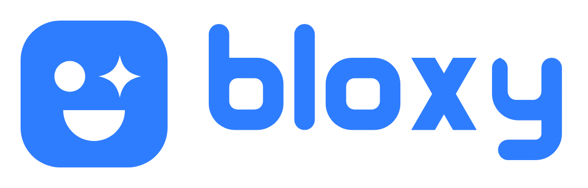

# Bloxy logo guidelines

**Spark Brick.** A top-down 2-stud brick that winks. One stud is round, and the other is a four-point spark, the AI. Underneath is a wide smile. It's a brick and a building buddy in one shape.

## Files

| Use | File |
| --- | --- |
| Symbol (master, Blox Blue) | `logo/bloxy-symbol.svg` |
| Symbol, small sizes (≤ 32 px) | `logo/bloxy-symbol-small.svg` |
| App / OS icon (full-bleed blue, white features) | `logo/bloxy-app-icon.svg`, `export/icon-*.png`, `export/apple-touch-icon.png` |
| Horizontal lockup, light backgrounds | `logo/bloxy-horizontal.svg` |
| Horizontal lockup, dark backgrounds | `logo/bloxy-horizontal-reversed.svg` |
| Stacked lockup | `logo/bloxy-stacked.svg`, `logo/bloxy-stacked-reversed.svg` |
| Wordmark only | `logo/bloxy-wordmark.svg` |
| One-colour versions | `export/*-black.svg`, `export/*-white.svg`, `export/*-mono-2f7dff.svg` |
| Favicon set + manifest | `export/favicon.ico`, `export/favicon.svg`, `export/site.webmanifest`, `export/head-snippet.html` |
| Presentation board | `board/bloxy-logo-board.html`, `board/slides/` |

All artwork is pure vector paths: no live text, no rasters, no effects.

## Colour

| Name | HEX | RGB | Use |
| --- | --- | --- | --- |
| **Blox Blue** | `#2F7DFF` | 47 125 255 | The symbol, primary buttons, app icon |
| Ink | `#050506` | 5 5 6 | Wordmark on light, app background |
| Sky | `#7FB0FF` | 127 176 255 | Highlights and links on dark |
| Signal | `#34E0A1` | 52 224 161 | Live / connected states only |

The symbol is always Blox Blue, white or black, never a gradient. The wordmark is Ink on light backgrounds and white on dark ones. White text on Blox Blue reaches 3.7:1, which is fine for large text and UI, but use Ink for small text on blue.

## Clear space and minimum size

- **Clear space:** keep at least the height of the round eye (about 1/6 of the symbol) clear on every side.
- **Minimum size:** the symbol at 16 px uses the small-size cut. The horizontal lockup should be at least 96 px wide.

## Don't

- Don't tilt or rotate the symbol. Bloxy stays upright, and that's what keeps it apart from Roblox's tilted square.
- Don't add studs, outlines, shadows, gradients or a robot face.
- Don't swap the spark and the round eye, or replace the spark with another shape.
- Don't set "Bloxy" in another font next to the symbol. Use the wordmark file.
- Don't put the blue symbol on mid-blue or busy backgrounds. Use the white version there.

## Typography (product)

The wordmark is custom drawn. In the product UI, use **Bricolage Grotesque** for display type and **Geist** for text, both from Google Fonts under the OFL.

## Notes

- Trademark: no clearance search has been done. Before registering or printing at scale, run a professional search (trademark databases plus a reverse image search).
- The concept round is kept in `concepts/` for reference.
